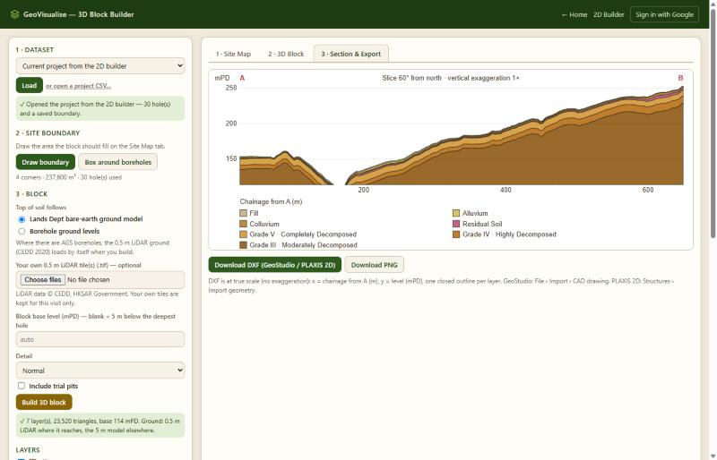
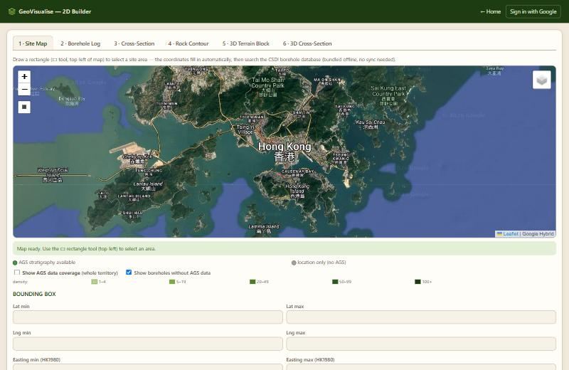
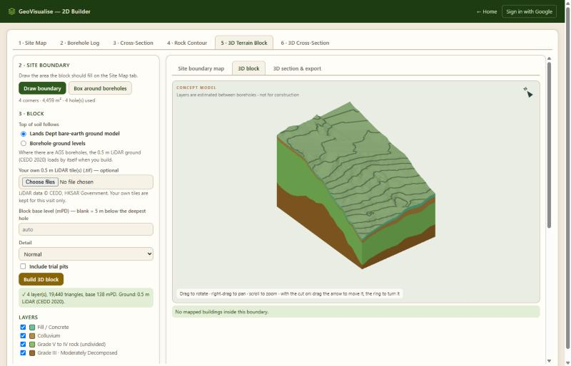
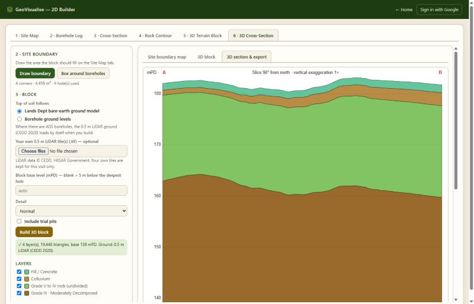
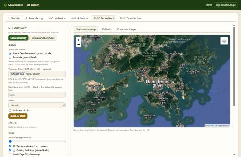
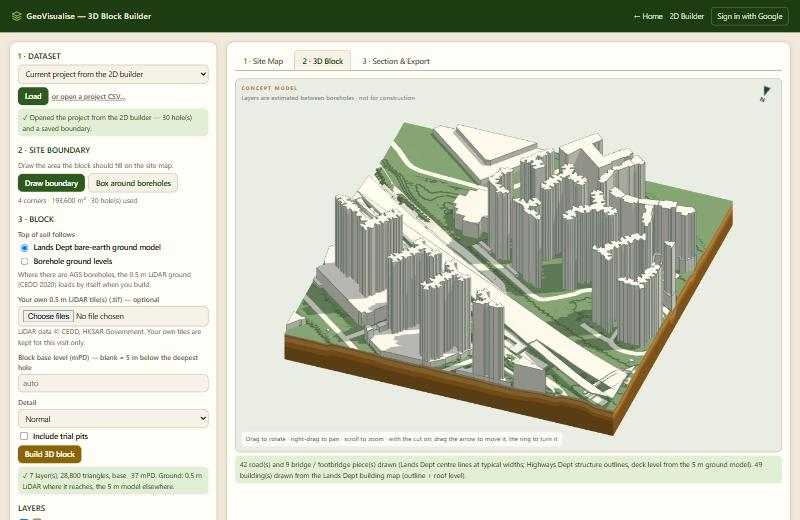
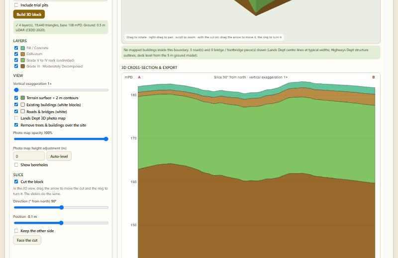

# 3D Block Builder — test report (2026-11-11)

Every feature of the 3D block builder was run in a browser, screenshotted, fixed where
wrong, and screenshotted again.

## How it was tested

- **Test site:** 30 made-up boreholes over a 540 × 440 m hillside (around E 829 000,
  N 827 500), 7 soil/rock layers. Some layers are only 0.1–0.4 m thick and some are
  missing in places, because thin and pinched-out layers are what broke the display.
- **Ground:** the real 0.5 m LiDAR where hosted, the 5 m model elsewhere.
- **Also used:** the built-in hillside example (4 drillholes), an L-shaped boundary,
  and a site with no boreholes at all.
- The made-up boreholes have made-up ground levels, so borehole sticks and buildings
  do not sit exactly on the real ground in a few pictures. That is the test data, not a bug.

## Summary

| # | Problem | Status |
|---|---------|--------|
| 1 | Brown / orange soil colours bleeding through the green terrain on slopes | Fixed |
| 2 | Looking at a cut face, contour lines and layers from behind showed through | Fixed |
| 3 | Same from the opposite side of the cut | Fixed |
| 4 | A building on the edge of the block stuck out past the block | Fixed |
| 5 | Boreholes floating in space after a cut | Fixed (hidden by default, and cut with the block when shown) |
| 6 | A building sliced by the cut looked like a hollow box | Fixed |
| 7 | Photo map flickered in green stripes against the terrain | Fixed |
| 8 | Opening another dataset kept the previous dataset's options | Fixed |
| 9 | 3D tab with no boreholes failed silently | Fixed (clear message) |

Checked and found working, no change needed: layer on/off boxes, terrain on/off,
vertical exaggeration, L-shaped (concave) boundary, "borehole ground levels" option,
"Very fine" detail (147,000 triangles built in about 0.5 s), Site Map tab, Section tab,
DXF export, PNG export, project CSV download.

---

## 1 · Soil colours bleeding through the terrain

**Cause.** Each layer was drawn with a "pull toward the camera" setting that grows with
how steep the surface looks on screen. Deep layers got a bigger pull than the terrain
on steep ground, so they showed through it.

**Fix.** The pull is now a tiny fixed amount that only settles exact ties. It no longer
depends on steepness.

| Before | After |
|---|---|
|  |  |

Close-up after the fix:

## 2 and 3 · Things showing through the cut face

**Cause.** The same setting. Seen edge-on at a cut, the layers and the terrain's
underside were pulled in front of the flat cut face.

**Fix.** Same change as item 1. The cut face is now solid from every angle.

| Before | After |
|---|---|
|  |  |
|  |  |

Level view straight at the cut face, and an oblique view, after the fix:

The kept side seen from behind:

## 4 · Building sticking out past the block

**Fix.** Every building outline is now trimmed to the site boundary before it is drawn.
A building on the edge is sliced flush with the block's side. Works for any boundary
shape, including L-shapes.

## 5 · Floating boreholes

**Fix.** "Show boreholes" is now off by default. When switched on, boreholes on the
removed side of a cut are removed with it.

## 6 · Sliced building looked hollow

**Fix.** The inside faces of a building are drawn in one flat grey, so a building cut
by the section reads as a solid block.

| Before (grey open box at the right) | After |
|---|---|
|  |  |

Buildings close up:

## 7 · Photo map stripes

**Cause.** The photo map's triangles are metres wide; the LiDAR ground is 0.5 m. Laid
on the ground, the photo dipped under the terrain between its corners.

**Fix.** The photo map wins depth ties within about 2 m, and buildings stay in front of it.

| Before | After (with a cut) |
|---|---|
|  |  |

## 8 · Options carried over from the previous dataset

**Found by:** opening a dataset saved with "borehole ground levels", then one with no
saved options. The second one silently kept "borehole ground levels" (the bulls-eye
contours below are the giveaway).

**Fix.** A dataset with no saved value now gets the default for every option.

| Before | After |
|---|---|
|  |  |

## 9 · Other features checked

Layers hidden and terrain off (the brown patch is real: the ground there is at the block's base level):

L-shaped boundary, whole and cut:

Section tab and Site Map tab:

Exports: DXF (243 KB, valid header), PNG (122 KB), project CSV (12 KB) all produced.

Final run with all fixes in:

---

## 3D builder merged into the 2D builder

The 2D builder now has six tabs in workflow order. Tabs 5 and 6 show the 3D builder
inside the page and are given the current project automatically.

Tab 5 · 3D Terrain Block (built automatically; with no saved boundary it boxes the boreholes):

Tab 6 · 3D Cross-Section (the cut switches on by itself):

Checked:

- Switching between tabs 5, 6 and the 2D tabs does not rebuild the block.
- Saving in the 2D builder includes the 3D boundary, cut and options.
- For normal (non-admin) users tabs 5 and 6 stay locked:

- With no boreholes loaded, tab 5 used to fail silently (below). It now says
  "No boreholes yet. Load or enter boreholes in tabs 1 and 2 first".

## Not covered

- Dragging the red arrow and green ring by mouse (the sliders that do the same job were tested).
- Drawing a boundary by hand on the map (boundaries were supplied to the page instead).
- "Save changes" to a cloud dataset (needs a signed-in account).
- The live website's 3D pages: they are admin-only. The same code was tested on a local copy.

---

## Follow-up round (same day)

### Sliced buildings now show a solid white face

The earlier fix (grey inside faces) still let you see the far inside wall. Now, where the cut
line crosses a building's outline, a white panel is drawn on the cut plane from the building's
foot to its roof.

### Roads and bridges

Tested on a 440 x 440 m urban site near Sha Tin: 42 roads, 9 bridge pieces, 49 buildings.

Buildings switched off, to show the roads (white strips on the ground) and a flyover that
climbs from ground level to about 20 m:

Check on the deck levels: on nine flyover outlines the 5 m ground model sits about 16 m above
the bare-earth LiDAR, which confirms the 5 m model contains the bridge decks.

### One 3D tab

Tab 6 is gone. Tab 5 holds the 3D block, with the section and export below it and the boundary
map below that. The inner tab row is removed, and the frame grows and shrinks with its content
(checked: 1376 px, 2161 px with a section, back to 1376 px).

### Not covered in this round

- Footbridge deck levels were not checked against a known footbridge. They are narrow compared
  with the 5 m ground model, so expect them to be rougher than flyovers.
- Road widths are assumed per road type; they were not compared with real kerb lines.
