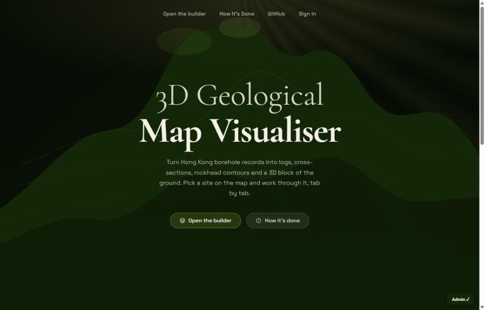
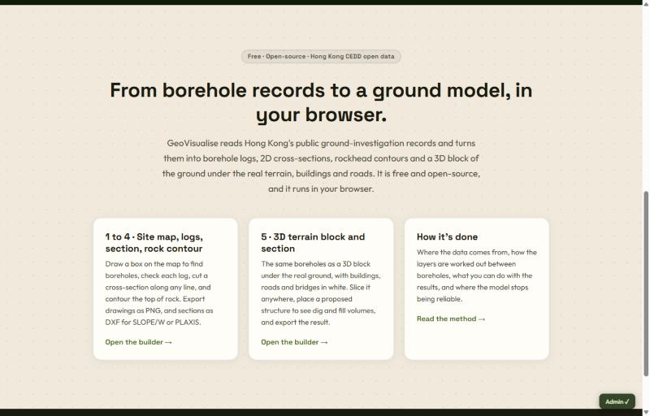
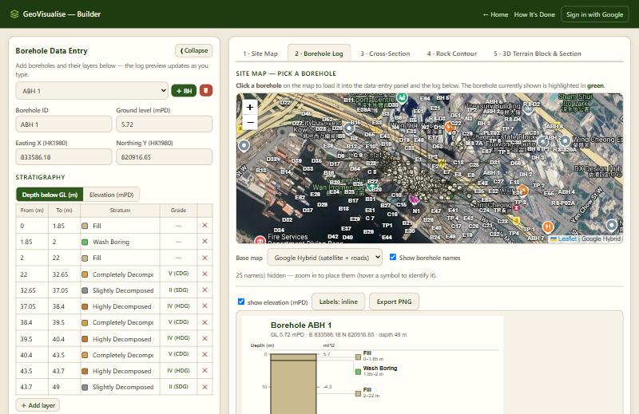
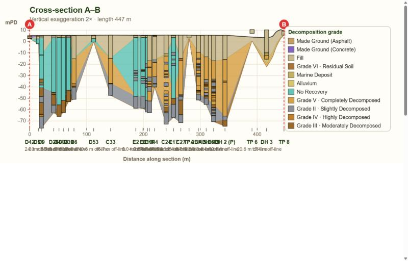
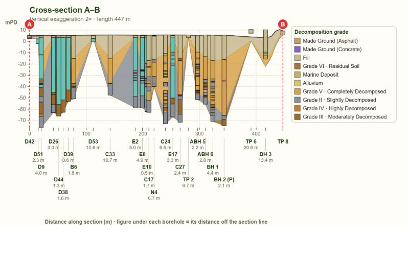
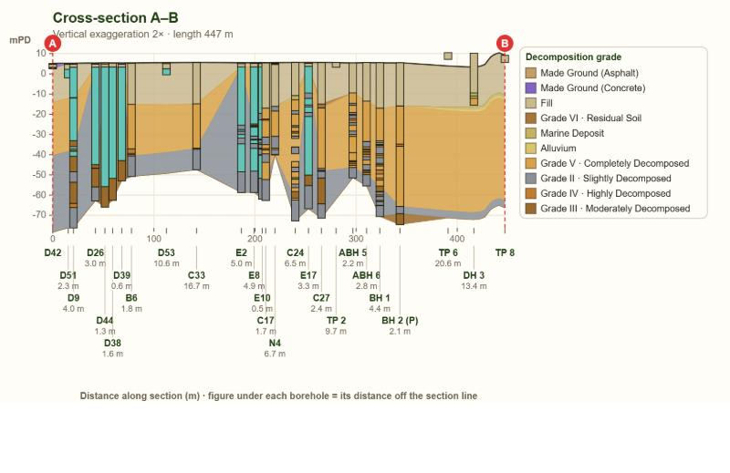
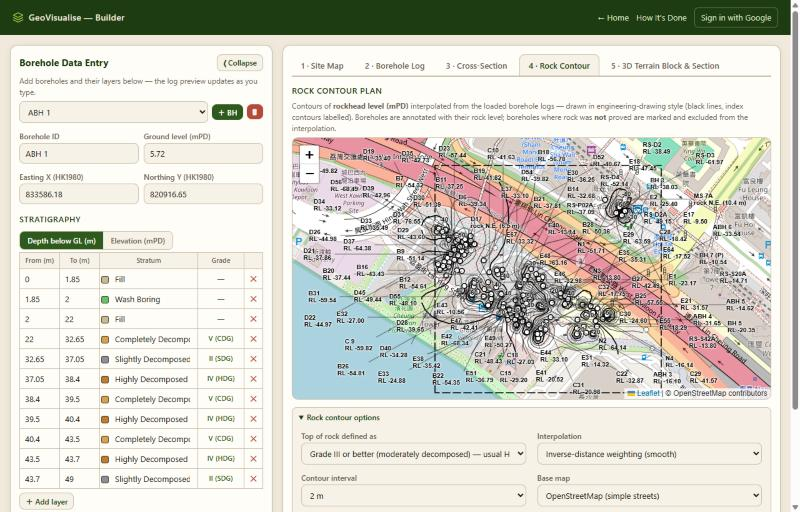
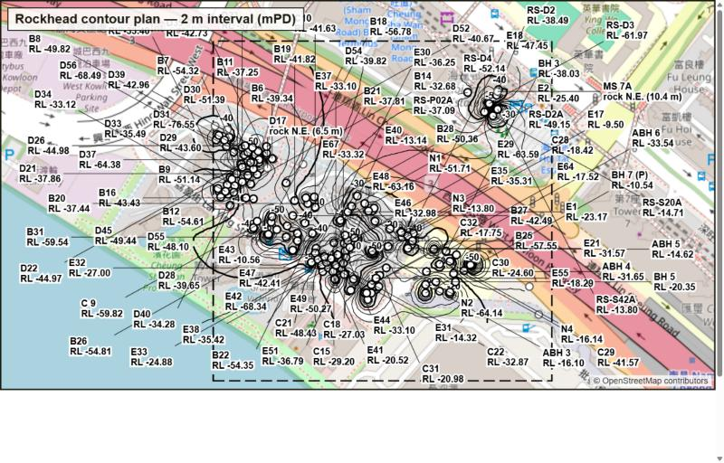
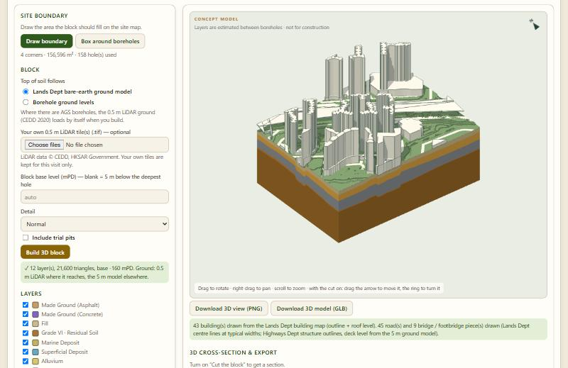
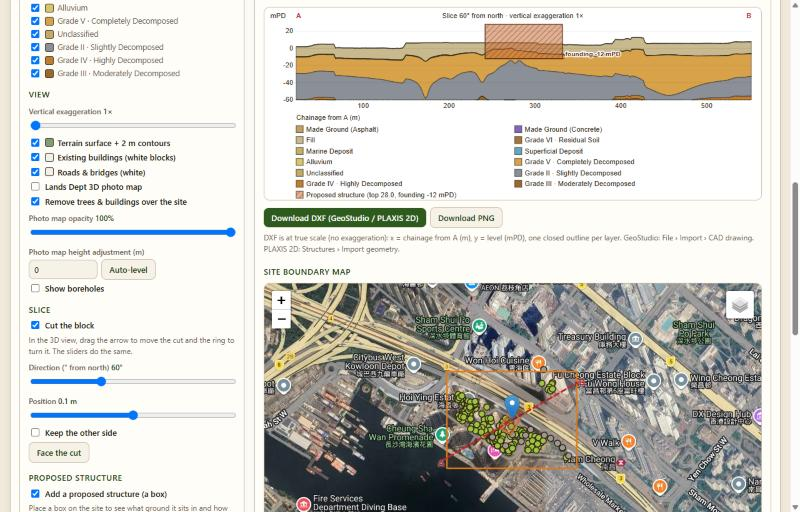

# Whole-site audit (2026-11-12)

The whole website was walked through in workflow order, from the landing page to the exports,
on a real site. Each problem was pictured, fixed, and pictured again.

## How it was tested

- **Real site:** a 400 × 400 m urban area (E 833 300–833 700, N 820 800–821 200).
  The site map found **215 boreholes, 202 with AGS logs**; 171 loaded with real layers in 12 seconds.
- **Flow followed:** landing page → site map → borehole log → 2D cross-section → rock contour →
  3D block and section → exports → proposed structure.
- Also used: the built-in hillside example and the made-up 30-hole test site from the earlier report.

## Summary

| # | Where | Problem | Status |
|---|---|---|---|
| 1 | Landing page | Text described an old method ("implicit structural modelling… upload and explore in 3D") | Fixed |
| 2 | Landing page | Separate "2D Builder" and "3D Builder" links, although it is now one builder | Fixed |
| 3 | Landing page | Footer said "All rights reserved" on an open-source project; three different product names | Fixed |
| 4 | Landing page | 17 unused style rules from the old embedded viewer | Removed |
| 5 | Site map | Typing HK1980 eastings / northings was ignored; only latitude / longitude worked | Fixed |
| 6 | Site map | Dead button "Send to 3D Builder (not built)" | Removed |
| 7 | Site map | Density colour key always shown, even with the density layer off | Fixed |
| 8 | Site map | No step-by-step guidance; buttons still said "2D Builder" | Fixed |
| 9 | 2D section | Borehole names and off-line distances printed on top of each other | Fixed |
| 10 | 2D section | Legend box touched the B end of the section | Fixed |
| 11 | 2D section + 3D | "No Recovery" / "Wash Boring" joined up between boreholes as if a soil layer | Fixed |
| 12 | 2D section + 3D | A short borehole or trial pit pinched every deeper layer up to its toe (false V-shapes) | Fixed |
| 13 | Rock contour | Default 2 m interval drew dozens of rings on a site with a 60 m range of rock level | Fixed (interval picks itself; 10 m option added) |
| 14 | 3D tab | The 3D block could not be exported | Added: picture (PNG) and model (GLB) |
| 15 | 3D tab | No way to test a proposed structure against the ground | Added (see below) |

Checked and found working, no change needed: borehole log tab and its PNG export, site plan PNG export,
2D section DXF export, rock contour PNG export, 3D layer toggles, buildings, roads and bridges on a real
urban site, section legend with 13 entries (no overlap), frame height in the merged 3D tab.

---

## 1–4 · Landing page

One "Open the builder" link instead of two, text that matches what the site does, a third card
for "How it's done", an honest footer.

## 5–8 · Site map

Typing a box in HK1980 now fills the latitude / longitude boxes, draws the rectangle and zooms to it.
Result on the test site: "Found 215 borehole(s) — 202 with AGS stratigraphy".

## Borehole log (tab 2)

Works with the real logs. No change.

## 9–12 · 2D cross-section (tab 3)

The exported PNG on a line with 30+ boreholes.

**Before:** names and off-line distances unreadable, legend over the B end, a teal "No Recovery"
band across the section, and V-shaped pinches at every short hole.

**After the label and legend fix** (names drop into rows with leader lines; "No Recovery" is no
longer a band):

**After the "stopped early" rule** (a borehole only speaks for layers it drilled through; the layers
now run on beneath the short holes D53, TP 2, TP 6, DH 3, TP 8):

## 13 · Rock contour (tab 4)

Works and exports. On this site the interval now starts at 5 m instead of 2 m.

## 3D block and section (tab 5)

The real site: 12 layers, 43 buildings, 45 roads, 9 bridge pieces.

Cut through a proposed structure, seen square-on:

Section with a 13-entry legend, the structure hatched and labelled, and the boundary map below:

## 14–15 · New: proposed structure and 3D exports

A box you place on the site: centre (typed, clicked on the map, or dragged), length, width,
rotation, founding level and height. It is drawn on the map, on the 3D block, on the cut face,
on the section and in the DXF, and it updates as you type.

The panel reports the dig and fill volumes, the volume dug from each layer, and what ground the
founding level sits on. Example from the real site (90 × 45 m, founding −12 mPD): 73,593 m³ to dig,
of which 41,247 m³ fill and 29,145 m³ Grade V; 96% of the base on Grade V.

Exports checked: 3D view PNG (945 × 646), 3D model GLB (4.2 MB, valid glTF header), section DXF
with a `PROPOSED_STRUCTURE` layer.

## Observations left as they are

- **"Unclassified" layers** appear where an AGS log has no usable material name. They are shown, not hidden.
- **Layer order** is one order for the whole site (by average depth). On this site Grade II rock is
  listed above Grade IV and III because of where it was most often logged.
- **One very deep borehole** sets the block base (−160 mPD here). Type a base level to trim it.
- **Sign-in and "My projects"** pages load, but saving to an account was not exercised.

## Not covered

- Dragging by mouse: the section line ends, the slice handle, the structure pin (their typed or
  slider equivalents were tested).
- Phone-width layout of the builder tabs.
- The live site's 3D tab (admin-only); the same code was tested on a local copy.
